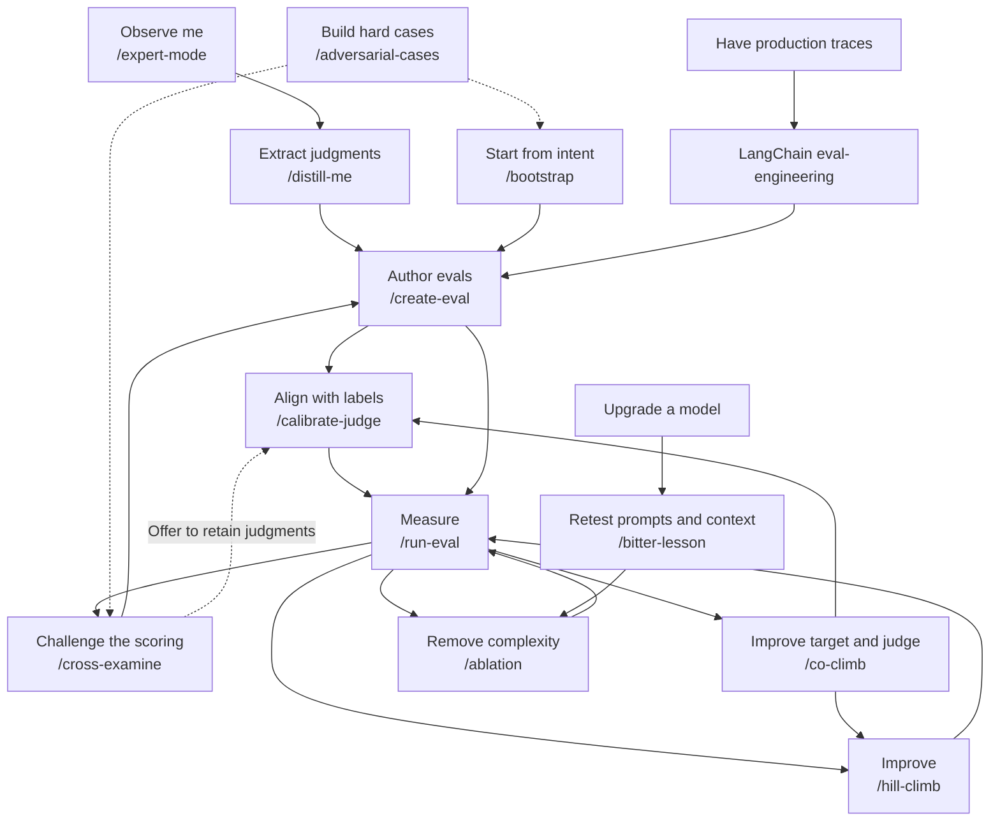

# cstack

Skills for eval-driven development. Turn expert judgment into evals, improve your agent against them, and simplify what no longer helps.

[One-page cheat sheet](docs/cstack-cheatsheet.pdf) — each skill, when to reach for it, the usual order, and the install command.

Not sure which skill fits the files you already have? Use [`/help`](skills/help/SKILL.md). Learning the pack on the playground? Use [`/tutor`](skills/tutor/SKILL.md). It walks exercises 01–13, one question at a time, and resumes from a checkpoint.

## Start with the evidence you have

Ask `/expert-mode` to observe you working, or use `/distill-me` after a session. Start with `/bootstrap` when you know the intent and need cases before you have useful traces.



With good production traces, use LangChain's [eval-engineering](https://github.com/langchain-ai/langchain-skills/tree/main/config/skills/eval-engineering) for grounded tasks, environments, and verifiers. It is referenced, not bundled.

| Skill | Use it to |
| --- | --- |
| [expert-mode](skills/expert-mode/SKILL.md) | Capture explicit judgments while you work. |
| [distill-me](skills/distill-me/SKILL.md) | Recover judgments from a session. |
| [bootstrap](skills/bootstrap/SKILL.md) | Interview for intent and review proposed scenarios. |
| [create-eval](skills/create-eval/SKILL.md) | Turn reviewed evidence into cases and graders. |
| [calibrate-judge](skills/calibrate-judge/SKILL.md) | Fit and validate a judge against labeled outcomes. |
| [run-eval](skills/run-eval/SKILL.md) | Execute evals and report what ran. |
| [cross-examine](skills/cross-examine/SKILL.md) | Reproduce scoring gaps and independently check repairs. |
| [adversarial-cases](skills/adversarial-cases/SKILL.md) | Construct targeted inputs, failures, and controls. |
| [hill-climb](skills/hill-climb/SKILL.md) | Improve a target within an eval budget. |
| [co-climb](skills/co-climb/SKILL.md) | Alternate target improvements and judge calibration in frozen blocks. |
| [ablation](skills/ablation/SKILL.md) | Remove complexity while preserving required performance. |
| [bitter-lesson](skills/bitter-lesson/SKILL.md) | Retest inherited prompt complexity as models improve. |
| [help](skills/help/SKILL.md) | Read the workspace and name the single next skill. |
| [tutor](skills/tutor/SKILL.md) | Practice exercises 01–13 with evidence, one question, and a checkpoint. |

Reviews [offer to retain useful corrections and labels](skills/expert-mode/references/calibration-capture.md) for later judge calibration. Saving a proposal does not confirm its label or activate Expert Mode.

Use [Co-Climb](skills/co-climb/SKILL.md) when apparent target failures may be judge errors. Keep multiple promising branches within a budget, alternate target changes and judge calibration in separate blocks, and re-score saved outputs after judge changes. Exploratory retention is separate from confirmed promotion. Reserve a sealed final comparison. The [co-climb decision eval](evals/co-climb/README.md) covers branch selection, evidence boundaries and judge handoffs.

## Name the validation

| Level | What it means |
| --- | --- |
| Untuned | The original target's baseline before optimization. |
| Synthetic injection cases | Constructed inputs and controlled failures. |
| Adversarial cases | Targeted attempts to expose failures or scoring gaps. |
| True labeled data | Human judgments on real examples, within their reviewed scope. |

Untuned describes the target; the other rows describe evidence. Playground checks use synthetic and adversarial cases. Keep independent labeled examples outside tuning. See the [validation notes](docs/validation.md).

## Install and try it

```bash
npx skills add theclaymethod/cstack \
  --skill expert-mode distill-me bootstrap create-eval run-eval cross-examine hill-climb co-climb adversarial-cases calibrate-judge ablation bitter-lesson help tutor \
  -a codex -a claude-code -a cursor --copy
```

Keep the skill folders together for shared references. Start a new agent session. Codex uses `$bootstrap`; Claude Code and Cursor use `/bootstrap`. See [installation options](docs/install.md).

From this checkout, create a disposable [playground](fixtures/playground/README.md):

```bash
python3 fixtures/playground/scripts/new_workspace.py --out eval-runs/playground
cd eval-runs/playground
python3 -m methods.run --out eval-runs/methods
```

Prefer [Harbor](skills/create-eval/references/formats.md) for new executable agent tasks; existing formats remain supported. [Synthetic generation](skills/adversarial-cases/references/synthetic-methods.md), [failure injection](skills/adversarial-cases/references/failure-methods.md), and [DSPy handoffs](skills/hill-climb/references/data-handoff.md) are references. Implementations stay in your project.

Capture stays local unless you request an export. Installing skills does not activate capture or upload data.

[Sources](SOURCES.md) · [MIT license](LICENSE)
