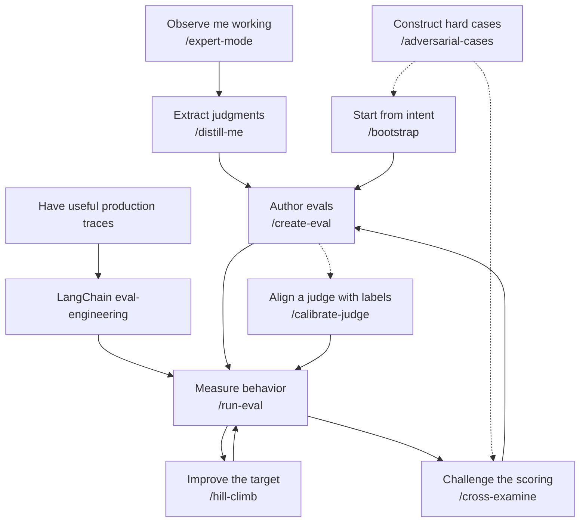

# C Stack

Skills for eval-driven development. Define the behavior you want, turn expert judgments into evals, and improve your agent against them.

## Choose a starting point

Use `/expert-mode` to observe your judgments as you work, or `/distill-me` to extract them from a completed session. Use `/bootstrap` when you know the intended behavior and need scenarios and evaluators before you have useful traces.



With useful production traces, use LangChain's [eval-engineering](https://github.com/langchain-ai/langchain-skills/tree/main/config/skills/eval-engineering) to build grounded tasks, environments and verifiers. It is an external skill, referenced here rather than bundled. C Stack's [trace guidance](skills/create-eval/references/ecosystem.md) explains the handoff.

| Skill | Purpose |
| --- | --- |
| [expert-mode](skills/expert-mode/SKILL.md) | Capture explicit judgments while you work. |
| [distill-me](skills/distill-me/SKILL.md) | Recover judgments from the session. |
| [bootstrap](skills/bootstrap/SKILL.md) | Interview for intent and review proposed scenarios. |
| [create-eval](skills/create-eval/SKILL.md) | Turn reviewed evidence into cases and graders. |
| [calibrate-judge](skills/calibrate-judge/SKILL.md) | Fit and validate a judge against labeled outcomes. |
| [run-eval](skills/run-eval/SKILL.md) | Execute and report evals. |
| [cross-examine](skills/cross-examine/SKILL.md) | Reproduce scoring gaps and check repairs independently. |
| [hill-climb](skills/hill-climb/SKILL.md) | Improve a target within an eval budget. |
| [adversarial-cases](skills/adversarial-cases/SKILL.md) | Construct targeted cases, failures and controls. |

## Formats and methods

Prefer [Harbor](skills/create-eval/references/formats.md) for new executable agent tasks. Existing project formats, DSPy datasets and lightweight stored-output evals remain supported.

The skills reference [synthetic generation](skills/adversarial-cases/references/synthetic-methods.md), [failure injection](skills/adversarial-cases/references/failure-methods.md) and a [DSPy handoff](skills/hill-climb/references/data-handoff.md). Implementations and dependencies belong in your project. The [playground fixture](fixtures/playground/README.md) demonstrates the methods with the native runner and an optional local DSPy environment.

## Validation levels

Report whether the target was tuned and which evidence supports its score.

| Level | What it establishes |
| --- | --- |
| Untuned | The original skill or target's baseline before optimization. |
| Synthetic injection cases | Behavior under constructed inputs and controlled failures. |
| Adversarial cases | Behavior against targeted attempts to expose failures or scoring gaps. |
| True labeled data | Agreement with human judgments on real examples, within their reviewed scope. |

Playground checks use synthetic and adversarial evidence. They do not establish performance on human-labeled production data. Reserve independent labeled examples for confirmation after tuning.

## Install

```bash
npx skills add theclaymethod/cstack \
  --skill expert-mode distill-me bootstrap create-eval run-eval cross-examine hill-climb adversarial-cases calibrate-judge \
  -a codex -a claude-code -a cursor --copy
```

Keep the skill folders together for sibling references. Start a new agent session. Codex uses `$bootstrap`; Claude Code and Cursor use `/bootstrap`. See [installation options](docs/install.md) for plugins and manual copying.

## Try it

From this checkout:

```bash
python3 fixtures/playground/scripts/new_workspace.py --out eval-runs/playground
cd eval-runs/playground
python3 -m methods.run --out eval-runs/methods
```

Capture stays local unless you request an export. Installing a skill does not activate capture or upload data. The [validation notes](docs/validation.md) distinguish synthetic fixture checks from model performance and production evidence.

[Sources and repository history](SOURCES.md). MIT [license](LICENSE).
