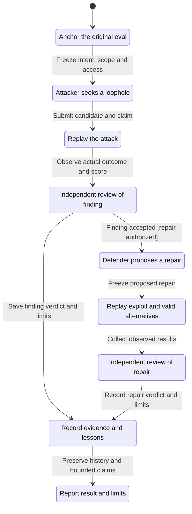

# Cross-Examine workflow and bounded model checks

The attacker seeks a scoring gap; the defender proposes a repair; a separate intent reviewer judges both against the original row. This is an optional design artifact, not a runtime dependency of the skill.



The chart combines runs sharing the same stage and hides terminal self-loops. It shows one bounded exchange; local candidate search and additional authorized rounds are abstracted out.

## What was checked

TLC2 2.19 (TLA+ tools release 1.7.4) explored 131 states and 151 transitions in the main model. All nine declared invariants, deadlock checking, and the eventual-report property held. The [main report](evidence/main/report.md) and [TLC output](evidence/main/tlc.out) preserve the result.

The original row permits two legitimate answers, A and B. The initial verifier also accepts an unsupported answer. The attacker can submit any of these and always claims success. The defender can propose a sound repair, reject everything, accept only A, rewrite the target, or retain the broken verifier while claiming success. The review gates evaluate observed outcomes and the preserved original intent, rather than those claims. A non-independent reviewer assignment leaves the verdict unreviewed.

The invariants require independent accepted judgments, a real replayed gap before accepting a finding, a confirmed authorized finding before accepting a repair, observed rejection of the exploit, preservation of both legitimate alternatives and original intent, confirmed evidence before a lesson, and a recorded report. Type consistency is checked too. Eventual reporting assumes fair scheduling of this finite exchange.

## Checks that the safeguards matter

Each control deliberately disables one safeguard. Exit 1 is expected for these configurations; exit 0 is expected for the main configuration. These are counterexamples in weakened hypothetical models, not newly discovered live-agent defects.

| Control | Counterexample |
| --- | --- |
| [Self-review](evidence/self-review/report.md) | An attacker, defender, or optimizer can confirm the finding: `ReviewIsIndependent` breaks after 4 steps. |
| [Trust claims](evidence/trust-claims/report.md) | An accepted finding need not correspond to a real gap (4 steps), and a fabricated repair can leave the exploit passing (7 steps). |
| [Reject everything](evidence/reject-all/report.md) | A defense can block the exploit by rejecting both valid answers: `ValidAlternativesRemain` breaks after 7 steps. |
| [Exact match](evidence/exact-match/report.md) | A defense can reject legitimate answer B while accepting A: the same invariant breaks after 7 steps. |
| [Rewrite intent](evidence/rewrite-intent/report.md) | A repair can pass replay while changing the declared target: `OriginalIntentPreserved` breaks after 7 steps. |

The 4-step path is anchor → submit candidate → replay → accept finding. The 7-step path continues through propose repair → replay → accept repair. Each linked report gives its numbered shortest path; TLC output retains the underlying values. [Proof results](proof-results.json) record configurations, exit codes, checks, and source hashes.

The unchanged existing calibration command also passed all 11 controls:

```sh
python3 evals/cross-examine/calibration.py eval-runs/cross-examine-role-calibration --executor local
```

[Calibration outcomes](calibration-summary.json) validate the existing artifact machinery. They do not evaluate whether agents adopt the revised roles or discover flaws independently. Use a new destination to rerun that command.

## Reproduce the model checks

Install or locate the Pstack `statechart` skill. Its runner uses a TypeScript-capable runtime and installs Java/TLC with mise if missing; those tools are only for reproducing this model. Work in a fresh scratch directory outside the repo:

```sh
statechart_runner=/path/to/statechart/scripts/statechart
model_scratch=$(mktemp -d)
cp CrossExamine.tla CrossExamine.cfg view.mjs "$model_scratch/"
cp -R controls "$model_scratch/"
"$statechart_runner" "$model_scratch/CrossExamine.tla" \
  --view "$model_scratch/view.mjs" --out "$model_scratch/main"
```

Run a weakened configuration in a new output folder; this example should exit 1 and identify the independent-review violation:

```sh
"$statechart_runner" "$model_scratch/CrossExamine.tla" \
  --config "$model_scratch/controls/self-review.cfg" \
  --view "$model_scratch/view.mjs" --out "$model_scratch/self-review"
```

Substitute trust-claims, reject-all, exact-match, or rewrite-intent to reproduce the other controls. Output folders must be new or empty. The specification and guards are identical across configurations; only named safeguard constants and proposed repair choices differ.

## Scope and assumptions

These are exhaustive finite-model checks, not an unbounded mathematical proof or a proof of agent behavior. The model assumes accurate role identities, trusted replay observations, a correct original intent interpretation, and completion of the modeled tool steps. It does not prove prompt compliance, context isolation, filesystem permissions, human/expert correctness, production generalization, or that a real reviewer resists persuasion. Those remain operational and review obligations. A fresh agent context is not an OS access boundary.

The defender's local hill climbing is abstracted into one frozen proposal; the independent reviewer supplies no per-candidate tuning scores in this model. Review-only scope, a non-independent reviewer assignment, and an attack with no actual scoring gap can end in a recorded limited result. Passing a bounded review does not establish immunity to reward hacking.

This update adds role and evidence requirements to the playbook. It adds no execution framework, database, container requirement, or unit-test files. Historical audit evidence remains frozen.

Published TLC logs normalize trailing blank lines only; original and published hashes are recorded in proof-results.json. A [fresh independent review and rerun](independent-review.md) reproduced all six model outcomes and found no blocking implementation gap.
